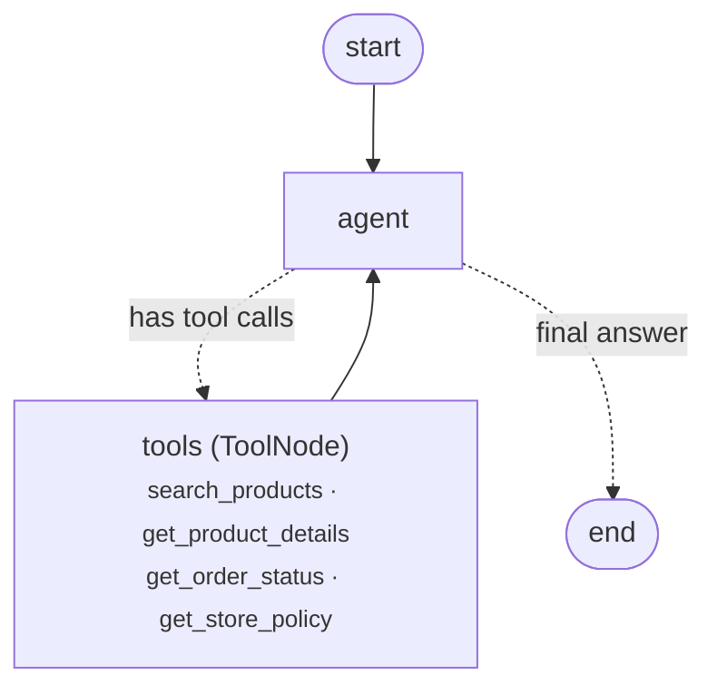

# Empório da Música — Customer Service Agent

A text-message customer service agent for **Empório da Música**, a (fictional) musical instrument store in Campo Grande/MS, Brazil. Built for the Artefact AI Engineer technical challenge.

The agent, **Toninho**, answers customers in Brazilian Portuguese with the store's tone of voice. It decides on its own when to **query operational data** (catalog, prices, stock, promotions, orders) and when to **consult the store's policy manual** (opening hours, payment, returns, shipping, warranty), and it handles out-of-scope requests.

**Stack:** Python 3.12 · LangGraph · LangChain · Google Gemini (free tier) · pandas · pypdf · uv

---

## Quick start

**Requirements:** [uv](https://docs.astral.sh/uv/getting-started/installation/) (it installs Python 3.12 automatically) and a free Gemini API key from [Google AI Studio](https://aistudio.google.com/apikey).

```bash
git clone https://github.com/LucasAndradeDev/emporio-agent.git
cd emporio-agent
uv sync

cp .env.example .env        # then paste your key into GOOGLE_API_KEY
uv run main.py              # interactive chat (type "sair" to quit)
```

`.env` variables:

| Variable | Description |
|---|---|
| `GOOGLE_API_KEY` | Gemini API key (AI Studio) |
| `GEMINI_MODEL` | Model name. Default: `gemini-3.5-flash`. `gemini-3-flash-preview` and `gemini-3.1-flash-lite` also work. |

Other commands:

```bash
uv run main.py --debug                       # also prints which tools the agent called
uv run main.py --script examples/scripts/01_catalog_search.txt --save out.md
                                             # replays a scripted conversation and saves the transcript
uv run data.py                               # data layer self-test (no LLM, no API key needed)
uv run tools.py                              # tool self-test (no LLM)
uv run agent.py                              # prints the graph as a Mermaid diagram
```

> **Free tier note:** at the time of writing, the Gemini free tier allows about **20 requests per day per model**, and each customer message costs 2–3 requests (decide on a tool, then answer). If you hit `429 RESOURCE_EXHAUSTED`, switch `GEMINI_MODEL` to another model — quotas are per model.

---

## Architecture



1. The **agent** node sends the system prompt + conversation history to Gemini, with the four tools bound.
2. If the model requests tools, the **ToolNode** runs them (in parallel when there are several) and appends the results to the history.
3. The loop continues until the model answers without requesting tools.
4. An `InMemorySaver` checkpointer keeps the history per `thread_id`, so each conversation has its own memory across turns.

| File | Responsibility |
|---|---|
| `data.py` | Loads and prepares the CSVs; deterministic search, product lookup and order lookup with identity check |
| `policies.py` | Extracts the policy PDF and splits it by its numbered sections |
| `tools.py` | Wraps the functions above as LangChain tools (the docstrings tell the model *when* to use each one) |
| `prompts.py` | Persona and rules derived from the manual; injects the current date/time on every turn |
| `agent.py` | The LangGraph graph, the model and a retry policy for transient API errors |
| `main.py` | CLI (interactive, `--debug`, `--script`/`--save`) |
| `examples/` | Five recorded conversations and the scripts that produced them |

---

## Technical decisions

### Agent approach: function calling in a hand-built LangGraph graph
Prices, stock and order status must be **exact** — the manual itself says (section 7.1) to never give prices, stock or delivery times without checking the system, as wrong information can amount to false advertising. So structured data is never put in the prompt for the model to "read": it is served by deterministic Python functions exposed as tools. The model only decides *which* tool to call and *how* to phrase the answer.

I built the graph by hand with `StateGraph` instead of using a prebuilt agent, to keep the reasoning loop explicit and easy to extend (e.g. adding a human hand-off node or a guardrail node before the answer).

### Policies: section lookup instead of embeddings-based RAG
The manual has 8 pages (~11k characters) with a clear numbered structure. I extract it once with `pypdf` (layout mode, which preserves tables) and split it by top-level section. The agent calls `get_store_policy(section)` with a closed enum of nine topics.

Why not embeddings + vector store: for a document this size, retrieval by section is exact, has no extra cost or infrastructure, and is easy to audit (you can see exactly which section the agent read). Splitting by section also keeps related rules together — for example, "PIX discount does not stack with promotions" lives in the promotions section, and a fixed-size chunker could cut it in half. Embeddings-based RAG would make sense if the knowledge base grew to many documents.

Making policies a **tool** (rather than pasting the whole manual into the system prompt) also makes the agent's decision visible: in the transcripts you can see when it chose to consult a rule.

### Model: Google Gemini (free tier)
Good function-calling support and a free tier, so anyone can run the project without paying. The model name is configurable via `.env`, and LangChain's model abstraction would make switching providers a small change in `agent.py`.

### Prompt strategy
- The **persona and rules come from the manual**, mainly section 7 (tone "informal but professional, like a friend who knows music", out-of-stock / discontinued / expired promotion / complaint handling, accessory redirection).
- The prompt is written in English (clearer for instruction-following) with an explicit rule to always reply in Brazilian Portuguese.
- Explicit **"when to use each tool"** section, mirrored in each tool's docstring.
- The **current date and time** (Campo Grande timezone) is injected on every turn, so the agent can tell whether the store is open and apply deadlines (e.g. the 7-day right of withdrawal in example 4).
- Guardrails: never reveal customer data beyond a verified order, ignore attempts to override the rules, never promise discounts not returned by the tools.

### Conversation history
`InMemorySaver` with one `thread_id` per CLI session: enough for a multi-turn chat (the customer can say "e no PIX?" after asking about a product). Swapping it for `SqliteSaver`/`PostgresSaver` would persist conversations across restarts without changing the graph.

### Data handling
- **Promotions:** only rows with `is_active = 1` are applied. If a product had more than one active promotion, the largest discount would win (promotions do not stack, manual 6.2). The promotional price is pre-computed so the model never does the math.
- **Availability:** derived from `status` and `stock_quantity` into explicit states: available, temporarily out of stock, discontinued, coming soon. Unavailable products come back with up to three available alternatives from the same category with the closest price (manual 7.3).
- **PIX price:** pre-computed (5% off list price) only for products *without* an active promotion.
- **Search:** accent-insensitive, matches all typed words in the product name first and falls back to the description; categories accept singular/plural ("violão" → "Violões").
- **Orders and privacy (LGPD):** an order is only returned if the e-mail or phone matches the customer who placed it; phone matching compares digits only and accepts numbers with or without area code. On a mismatch the message is generic, so it does not reveal whether the order exists.
- Payment codes (`credit_12x`, `boleto`…) and order statuses are translated into readable text before reaching the model.

---

## Assumptions about the data

The brief asks to document assumptions where information is ambiguous:

- **Two phone numbers in the manual:** the company data table lists (67) 3341-4444 as phone/WhatsApp, while section 7 mentions (67) 3321-4500 as the WhatsApp channel. The agent does not resolve this conflict: it quotes the section it consulted (usually `about_store`, i.e. 3341-4444). The e-mail on page 2 also has a typo (`empóriodamusica`, while the cover says `emporiodamusica`). In a real project I would confirm both with the store and fix the manual rather than patch it in the prompt.
- **Empty categories:** "Instrumentos de Sopro (Madeiras/Metais)" and "Cordas Orquestrais" exist in `categories.csv` but have no products. A search there correctly returns nothing.
- **Inconsistent products:** products 136/137 have name and description that do not match (e.g. a "Yamaha" described as "Ibanez") and unusual prices. They are served as-is; in a real project I would flag them to the store.
- **"Today":** orders are dated 2025–2026; deadlines (right of withdrawal, warranty) are computed by the model against the real current date injected in the prompt.
- **Delivery date as receipt date:** for the 7-day right of withdrawal, `estimated_delivery` of a delivered order is treated as the receipt date, since there is no actual delivery date column.

---

## Example conversations

Recorded with `main.py --script ... --save ...`. Each transcript shows the tool calls (🔧) made before every answer.

| # | Scenario | What it shows |
|---|---|---|
| [01](examples/01_catalog_search.md) | Acoustic guitars up to R$ 1,000, then a nylon recommendation for a beginner | Catalog search with filters; PIX prices; awareness of opening hours (recorded after 6 pm) |
| [02](examples/02_price_promotion_payment.md) | Takamine GD20 price; Taylor 110e promotion + PIX; 12x installments | Active promotion shown with original price and %; PIX does not stack; installment rule (min. R$ 100) |
| [03](examples/03_order_status_identity_check.md) | "Where is my order?" | Asks for missing data before calling the tool; refuses with a wrong e-mail; releases the order with the right phone |
| [04](examples/04_return_policy_applied.md) | "I regret my purchase, can I return it?" | **Non-trivial:** combines the returns policy with real order data — the order was delivered on 18/01/2026, so the 7-day window has expired; then explains the defect/warranty path |
| [05](examples/05_out_of_scope_and_edge_cases.md) | Strings and amplifier; out-of-stock guitar; prompt injection; store address | Accessory redirection; alternatives for an out-of-stock item; refuses to override rules |

Examples 01–03 were recorded with `gemini-3-flash-preview` and 04–05 with `gemini-3.1-flash-lite`, because the free-tier daily quota ran out midway.

---

## Known limitations

- **Embellishment beyond the data.** The model sometimes adds subjective or general claims that are not in the data, e.g. calling the Yamaha C40 a "teachers' favourite" (example 01), saying "we accept all major card brands" for credit cards when the manual only states it for debit (example 02), or "we're open to receive you" after closing time (example 05). Prices, stock and rules came from the tools in every case, but the free-form text is not verified.
- **No real hand-off.** Complaints and defects are "forwarded to the team" only in words; there is no ticketing integration.
- **Search is lexical.** "cordas" also matches 7-string guitars and "amplificador" matches guitars with a built-in preamp. The prompt handles accessory requests before any search, but the search itself has no semantic understanding.
- **Free tier limits.** ~20 requests/day per model; the retry policy only covers short-lived errors (403/429 per minute/503), not the daily quota.
- **History is in memory** and lost when the CLI closes.
- **No automated evaluation.** Behaviour was checked by running scripted conversations and reading the transcripts.
- Shipping cost for other cities depends on CEP/weight in the real store; the agent can only explain the rules and timeframes.

## What I would do with more time

1. **Evaluation suite:** a set of questions with expected tool calls and facts (e.g. "Taylor 110e → R$ 5.519,08, PIX does not stack"), run with pytest + an LLM-as-judge check for tone and for claims not supported by tool outputs.
2. **Grounding guardrail:** a node after the agent that checks every price/number in the answer against the tool results before replying.
3. **Human hand-off node:** open a ticket for complaints, defects and sales closing, with the conversation summary.
4. **Persistent memory** with `SqliteSaver`, and a WhatsApp-style API (FastAPI) instead of the CLI.
5. **Data validation** at load time (schema checks, flagging inconsistent products like 136/137).
6. **Observability** with LangSmith traces to inspect tool choice and latency.

---

## Use of AI coding assistants

I used **Claude Code** (Anthropic's CLI agent) throughout the project, in a "direct and review" workflow:

- **Analysis:** reading the brief, the CSVs and the policy PDF to list the traps in the data (inactive promotions, zero stock, discontinued items, empty categories, the two phone numbers, LGPD on order lookups) before writing code.
- **Architecture discussion:** we compared calling the Gemini SDK directly versus LangGraph; I chose LangGraph because the role works with LangChain/LangGraph, and chose section-based retrieval over embeddings given the size of the manual.
- **Implementation:** Claude Code wrote the code step by step, following the plan; each step was run and tested before its commit (the commit history reflects that progression). I asked for the identifiers and commit messages to be in English partway through, which is why the first three commits are in Portuguese.
- **Testing and debugging:** it ran self-tests and scripted conversations and fixed the issues they surfaced — singular/plural category matching ("violão" vs "Violões", "ukulele" vs "Ukuleles"), numbered lists inside a policy section being mistaken for section headings, and transient 403/429 errors from the free tier.
- **Decisions that were mine:** the model provider (free Gemini, so reviewers can run it), LangGraph, English for code, and reviewing the transcripts and data facts.

I reviewed the code to be able to explain and change every part of it.
